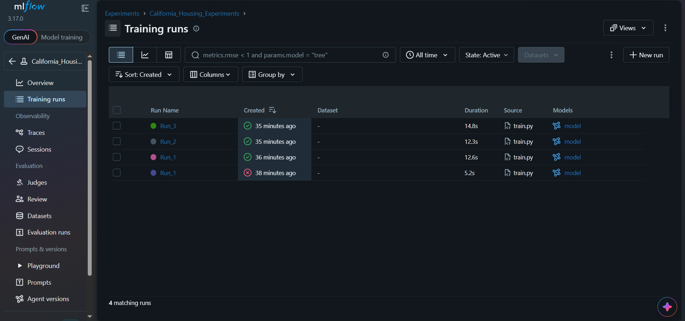

# MLflow Experiment Tracking — California Housing

## 1. Project Overview

This project demonstrates how to track, compare, and select machine learning experiments using MLflow.

The California Housing dataset is used to train three `GradientBoostingRegressor` models with different hyperparameter configurations. Each experiment logs its parameters, validation metrics, and trained model artifact to MLflow.

## 2. Dataset and Model

* **Dataset:** California Housing
* **Training split:** 80%
* **Validation split:** 20%
* **Random seed:** 42
* **Model:** GradientBoostingRegressor
* **Tracking tool:** MLflow

## 3. Hyperparameter Configurations

| Run   | Max Depth | Learning Rate |
| ----- | --------: | ------------: |
| Run 1 |         3 |           0.1 |
| Run 2 |         5 |          0.05 |
| Run 3 |         7 |          0.01 |

## 4. Evaluation Results

| Run   | Max Depth | Learning Rate |   RMSE |    MAE |     R² |
| ----- | --------: | ------------: | -----: | -----: | -----: |
| Run 1 |         3 |           0.1 | 0.5422 | 0.3716 | 0.7756 |
| Run 2 |         5 |          0.05 | 0.5198 | 0.3531 | 0.7938 |
| Run 3 |         7 |          0.01 | 0.6973 | 0.5311 | 0.6290 |

## 5. Best Model

**Selected model: Run 2**

* Max Depth: 5
* Learning Rate: 0.05
* RMSE: 0.5198
* MAE: 0.3531
* R²: 0.7938

Run 2 was selected because it achieved the lowest validation RMSE among the three tested configurations. It also achieved the lowest MAE and the highest R² in this comparison.

## 6. MLflow Results Screenshot

The following screenshot shows the experiment results recorded in the MLflow UI.



## 7. How to Run the Project

### Prerequisites

* Python
* Internet connection for the initial dataset download

### Installation

Clone the repository and navigate to the project directory:

```bash
git clone https://github.com/Salsabel-Osama/mlflow-task
cd mlflow-task
```

Create and activate a virtual environment.

On Windows PowerShell:

```powershell
py -m venv .venv
.\.venv\Scripts\Activate.ps1
```

Install dependencies:

```bash
python -m pip install -r requirements.txt
```

### Run the experiments

```bash
python train.py
```

### Open the MLflow UI

In a separate terminal, run:

```bash
python -m mlflow ui --host 127.0.0.1 --port 5000
```

Open the following address in your browser:

http://127.0.0.1:5000

Select `California_Housing_Experiments` to compare the recorded runs, metrics, parameters, and model artifacts.

## 8. Learning Outcomes

This project demonstrates how to:

* Load and split a machine learning dataset.
* Train models with different hyperparameters.
* Evaluate regression models using RMSE, MAE, and R².
* Track experiments using MLflow.
* Log model artifacts.
* Compare experiments and select a model based on validation RMSE.
